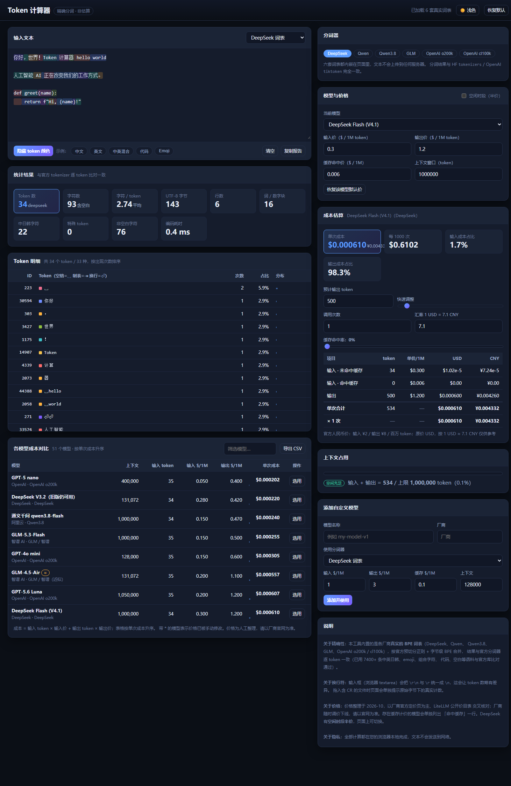

# Token 计算器

一个**离线、精确**的 token 计数器与 API 成本估算器。纯前端单文件，
双击打开 HTML 即可使用，文本不会发送到任何服务器。



## 下载

| 版本 | 文件 | 说明 |
| --- | --- | --- |
| 网页端（直接运行） | `token-calculator-v1.0.0.html` | 6.4 MB，双击即用，完全离线 |
| 网页端（含文档） | `token-calculator-web-v1.0.0.zip` | 含 HTML + LICENSE + 中文使用说明 |
| 源码 | `Source code (zip)` | 自己构建请见下方「构建」 |

本项目**没有桌面端**，只有网页端：单文件 HTML 就是完整程序。

## 核心特点

**1. 精确，不是估算。**
内置各厂商**真实的 BPE 词表**（不是用「1 token ≈ 0.75 词」之类的经验公式去猜）：

| 分词器 | 覆盖模型 | 词表大小 | 是否精确 |
| --- | --- | --- | --- |
| DeepSeek | DeepSeek-V3 / V3.2 / V4 系列 | 127,997 | ✅ 精确 |
| Qwen | Qwen2.5 / Qwen3 / 通义千问 | 151,643 | ✅ 精确 |
| Qwen3.8 | Qwen3.8 系列 | 248,044 | ✅ 精确 |
| GLM | GLM-4.6 / GLM-5 系列 | 154,820 | ✅ 精确 |
| OpenAI o200k | GPT-4o / GPT-5 系列 | 199,998 | ✅ 精确 |
| OpenAI cl100k | GPT-4 / GPT-3.5 / embedding-3 | 100,256 | ✅ 精确 |

分词流程完全对齐官方实现：按各家 tokenizer.json 里的**预切分正则**切分
（DeepSeek 的数字分步 + 中日文分支、Qwen 的 NFC 规范化、GLM 的
`ignore_merges` 语义等细节都还原了），再做字节级 BPE 合并。
结果与 HuggingFace `tokenizers` / OpenAI `tiktoken` **逐 token 一致**。

**2. 已经过验证。**
用 7400+ 条语料（中英日韩、emoji、组合字符、RTL、代码、JSON、URL、
各种空白与换行）与官方库逐条比对：**7398/7398 完全一致**。

## ⚠️ 关于精确性的边界（请务必阅读）

**以下四家的 token 数是「近似值」，不是精确值**，因为它们**没有公开可用于本项目的词表**：

| 厂商 | 处理方式 | 表格中的标记 |
| --- | --- | --- |
| **Anthropic**（Claude 系列） | 使用 OpenAI `cl100k` 词表近似 | `≈` |
| **Google**（Gemini 系列） | 使用 OpenAI `o200k` 词表近似 | `≈` |
| **月之暗面**（Kimi 系列） | 使用 DeepSeek 词表近似 | `≈` |
| **字节豆包**（Doubao 系列） | 使用 OpenAI `cl100k` 词表近似 | `≈` |

这些行在界面上会显示黄色的 `≈` 标记。**它们的分词结果可能与真实值有偏差**，
请仅作粗略参考。上表中列出的六套词表则是精确的。

## 关于价格

- 价格整理于 **2026-10**，以各厂商官方定价页为主，并用 LiteLLM 公开价目表交叉核对。
- 厂商会随时调价、改名、下线模型。整理时发现 `deepseek-chat` / `deepseek-reasoner`
  别名已停用，`qwen-turbo`、`doubao-1.5-pro`、`kimi-k2` 也已不在当前价目表中
  —— 这些**都没有**被当作现行价格列出。
- 人民币计价（豆包）与美元计价**不做静默换算**，会明确标注币种。
- 界面上的价格都可以直接修改，也可以添加自定义模型。
- DeepSeek 有**空闲时段半价**，可在界面上直接勾选。

## 功能

- **Token 可视化**：按 token 着色显示切分结果，每 20000 个 token 以内实时高亮
- **统计**：token 数、字符数、UTF-8 字节、行数、词数、中日韩字符数、编码耗时
- **Token 明细**：按出现次数排序，空格/制表/换行可视化（␣ ⇥ ⏎）
- **成本对比**：60+ 个模型横向对比，可筛选、可排序、一键「选用」
- **成本估算**：区分输入/输出/缓存命中计价，支持调用次数、输出长度、缓存命中率、汇率
- **上下文占用**：进度条 + 超限告警
- **导出**：CSV（含 UTF-8 BOM，Excel 直接打开不乱码）、复制文字报告
- **其他**：深浅色主题、拖入文件、自定义模型、设置本地保存

## 构建

本项目运行时**零依赖**，构建与测试需要 Python 3 与 Node.js。

```bash
# 1) 生成内嵌词表数据（需联网下载官方词表，约 50 MB）
python build/make_data.py

# 2) 生成官方库的参考分词结果（用于校验，需 pip install tokenizers tiktoken）
python build/gen_ref.py corpus   # 47 条结构化语料
python build/gen_ref.py fuzz     # 1200+ 条随机语料

# 3) 校验分词精确性
node build/verify.js corpus      # 应有 282/282 一致
node build/verify.js fuzz        # 应有 7398/7398 一致

# 4) 打包单文件版
python build/bundle.py           # 产出 Token计算器-单文件版.html

# 5) 浏览器端测试（需本机安装 Edge）
python -m http.server 8791       # 另开一个终端
node build/cdp_test.js           # 交互测试
node build/browser_test.js       # 渲染测试
```

也可以只跑分文件版（`index.html`），但需要本地服务器，因为要 `fetch` 词表数据。

## 目录结构

```
index.html                 分文件版入口
Token计算器-单文件版.html   自包含单文件版（构建产物，从 Releases 下载）
LICENSE                    GNU GPL v3.0
src/
  encoder.js               分词引擎（预切分 + BPE + 词表解析）
  models.js                模型目录：分词器、上下文、价格
  app.js                   界面逻辑
  styles.css               样式
build/
  make_data.py             从官方词表生成 tokenizer_data.b64
  tokenizer_data.b64       内嵌词表数据（gzip + base64，6.6 MB）
  gen_ref.py               用官方库生成参考分词结果
  expected.json            47 条结构化语料的参考结果
  expected_tokens.json     逐 token 参考结果
  fuzz_expected.json       1200+ 条随机语料的参考结果
  verify.js                精确性校验
  cdp_test.js              无头浏览器交互测试
  browser_test*.js         页面渲染测试
  bundle.py                打包单文件版
  bench.js                 性能测试
  eval_page.js             在真实页面执行 JS 的调试工具
  shot.js                  页面截图
```

## 已知限制

- **换行符**：浏览器的 `<textarea>` 会把 `\r\n` 和 `\r` 统一成 `\n`，
  这会让 token 数略有不同。拖入含 CR 的文件时，页面会**单独提示**按原始字节
  统计的真实 token 数，而不是悄悄给出偏差值。
- **首次加载**：词表数据约 6.6 MB（gzip 后），首次打开需要一点时间；之后浏览器会缓存。
- **高亮上限**：token 数超过 20000 时会暂停彩色高亮以保证流畅（**计数仍然精确**）。
- **近似分词器**：Anthropic / Gemini / Kimi / 豆包 的 token 数见上方「关于精确性的边界」。
- **价格为人工整理**：可能滞后于厂商调整，请以官网为准。

## 性能

单次编码 28000 字符（中英混合）约 20 ms，约 **140 万字符/秒**；
解压并解析 6 套词表约 0.7 秒。

## 许可

本项目采用 **GNU General Public License v3.0**（GPL-3.0）开源，全文见 [LICENSE](LICENSE)。

这意味着您可以自由使用、修改和分发本软件，但**衍生作品也必须以 GPL-3.0 开源**，
并且必须保留版权声明。本软件按「现状」提供，不附带任何担保。

### 第三方组件

本项目**未捆绑**任何第三方运行时库，全部为原生 JavaScript 实现。构建与测试阶段使用：

| 组件 | 用途 | 许可 |
| --- | --- | --- |
| HuggingFace `tokenizers` | 生成参考分词结果（仅开发阶段） | Apache-2.0 |
| OpenAI `tiktoken` | 生成参考分词结果（仅开发阶段） | MIT |
| Python / Node.js | 构建脚本与测试 | PSF / MIT |

内嵌的词表数据来自各模型官方发布（详见 `build/make_data.py` 中的来源清单）。
